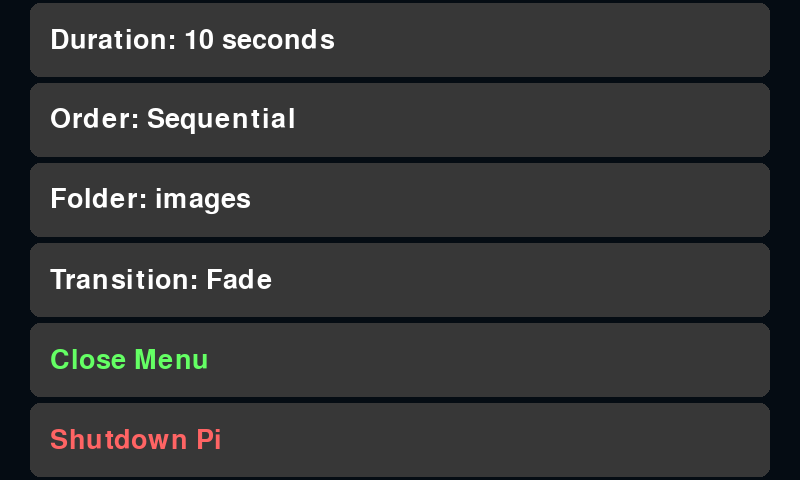
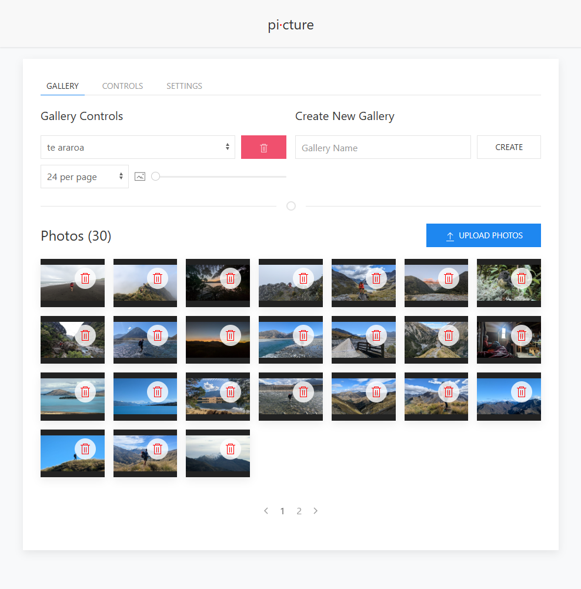
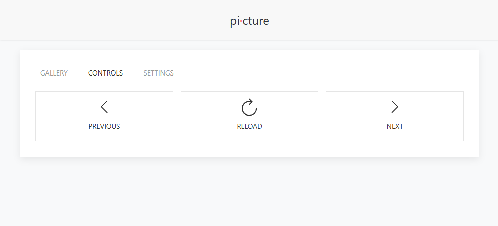
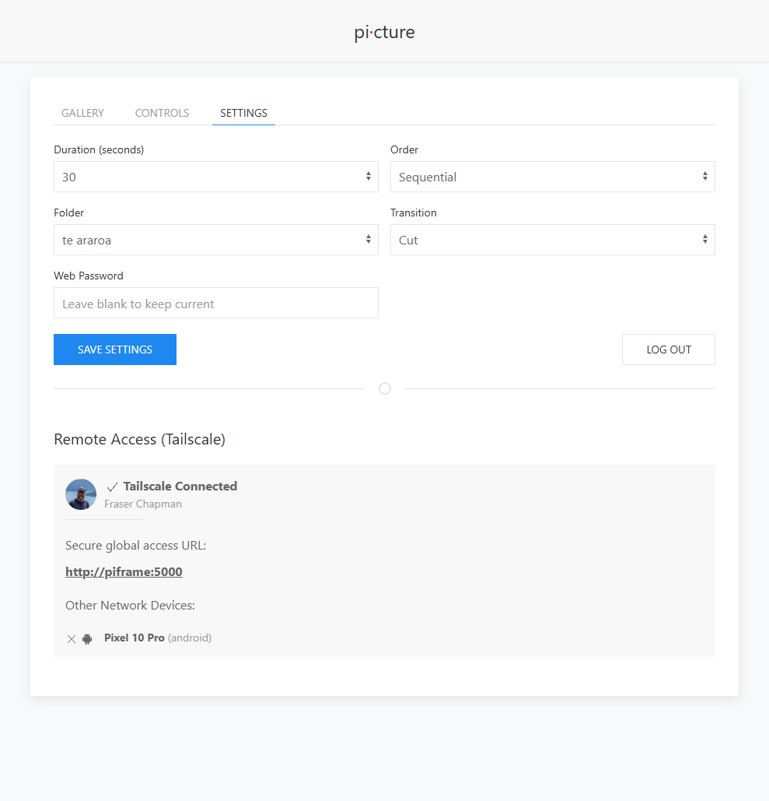

# pi·cture

A self-hosted digital photo frame for the Raspberry Pi. Built with Pygame and optimized to run natively on the DRM/KMS console via Wayland (`cage`) - meaning it boots quickly and runs smooth without the overhead of a full desktop environment.

## Prerequisites

1. A Raspberry Pi running Raspberry [Pi OS Lite](https://www.raspberrypi.com/software/operating-systems/) (e.g. `2026-06-18-raspios-trixie-arm64-lite`).
2. A supported screen (e.g., the Official Raspberry Pi 7-inch Touchscreen).

## Installation

An automated installation script is provided which will install the necessary dependencies, configure the correct user paths, and set up the background systemd service.

```bash
git clone https://github.com/FraserChapman/pi-cture
cd pi·cture
sudo ./install.sh
```

**Tailscale Integration (Optional)**  
If you want to securely access your photo frame's Web UI from your phone or anywhere in the world, append `tailscale` to the install command. This will seamlessly install and authenticate a zero-configuration VPN:

```bash
sudo ./install.sh tailscale
```

**Custom Port (Optional)**  
By default, the web UI runs on port 5000 (or whichever port you specified during install). If you have a conflict or prefer a different port, you can specify it during installation:
```bash
sudo ./install.sh --port 8080
```
*(You can also combine arguments: `sudo ./install.sh tailscale --port 8080`)*

Once installed, the service takes over `tty1` and starts automatically every time you boot the Pi. Cold boots are fully supported - the display driver will power up the screen naturally.

## Uninstallation

To remove the service and undo the boot configuration changes made by the installer:

```bash
sudo ./uninstall.sh
sudo reboot
```

Installed packages are left in place by default. Append `packages` to also remove `cage`, `python3-pygame`, `python3-flask` and `python3-werkzeug`, and `tailscale` to log out of and remove Tailscale:

```bash
sudo ./uninstall.sh packages tailscale
```

Your photos and settings are kept; delete the `pi·cture` directory afterwards if you no longer need them.

## Physical Touch Interface

You can use the physical touch screen to control the slideshow:

- **Tap the left half of the screen:** Go to the previous image.
- **Tap the right half of the screen:** Go to the next image.
- **Long-press anywhere (1+ seconds):** Open the on-screen menu to set the gallery, duration, order, transition, or safely shutdown the Pi.

### On-screen Menu



## Web Interface Dashboard

The photo frame runs a local web server on port 5000 (or whichever port you specified during install). It allows you to effortlessly manage your photo frame from the couch or from the other side of the world.

To access the dashboard:
1. Open a browser on your phone or computer.
2. Go to: `http://<your-raspberry-pi-ip>:5000` (or `http://<hostname>:5000`).
3. Log in with the default password: **`admin`**

### Gallery



### Controls



### Settings



### Features:
- **Galleries:** Create infinite custom folders (e.g., "Vacation", "Family") and upload photos in bulk using the drag-and-drop uploader.
- **Settings:** Seamlessly switch the active gallery playing on the physical frame, adjust the slideshow duration, toggle random/sequential order, and change the transition animation (Cut, Fade, Slide).
- **Security:** Easily change your web dashboard password from the Settings tab.
- **Tailscale Dashboard:** If you installed Tailscale, the Settings tab features a live widget showing your global access URL and the network status of your other Tailscale devices.

## Remote Access (Global Uploads)

If you chose to bundle [Tailscale](https://tailscale.com/) during installation:

1. Install the Tailscale app on your phone, laptop, or tablet and log in with your account.
2. Thanks to Tailscale's [MagicDNS](https://tailscale.com/docs/features/magicdns), you don't even need to remember IP addresses. You can securely access the frame's web UI from anywhere in the world by simply navigating to `http://<hostname>:5000` (e.g. `http://piframe:5000`)!
